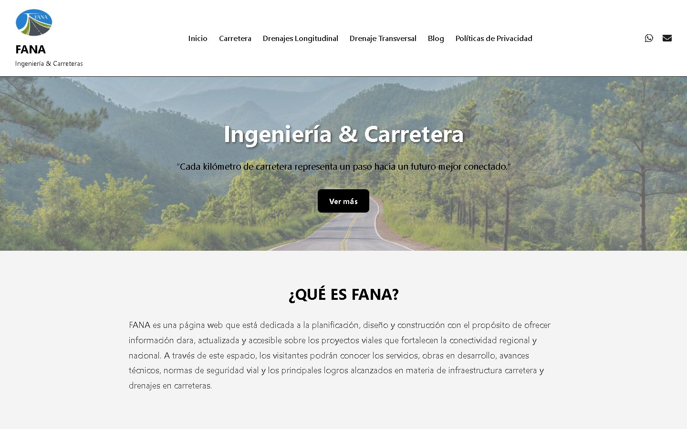
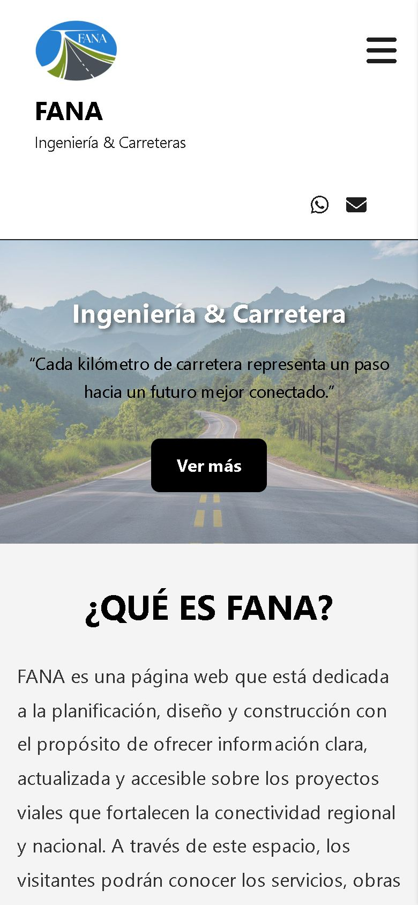
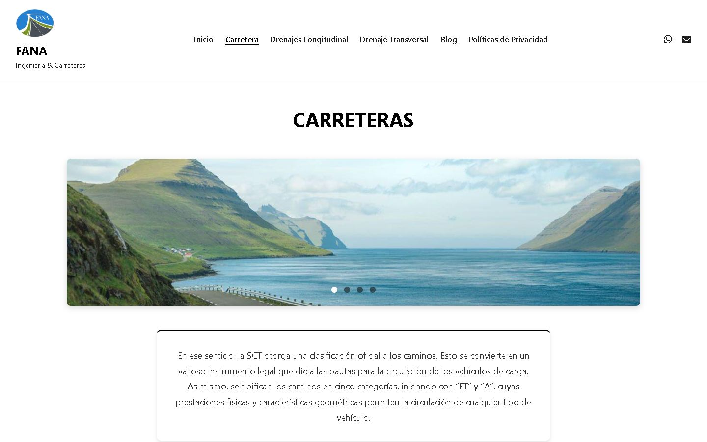

# FANA · Ingeniería & Carreteras

**Sitio informativo para una empresa de ingeniería vial.**

[**Ver sitio**](https://zerofuann-fs.github.io/fana/) · Proyecto freelance

Sitio estático para una empresa dedicada a la planeación, diseño y construcción de carreteras y drenajes. Explica sus servicios con contenido técnico e imágenes.

> **La empresa ya no opera.** El código se publica con permiso; los datos de contacto se reemplazaron por ejemplos.

## Funciones

- **Secciones técnicas:** carreteras, drenaje longitudinal y drenaje transversal, con carruseles de imágenes.
- **Carruseles hechos solo con CSS** (con botones de radio, sin librerías).
- **Blog** de proyectos y **políticas de privacidad**.
- Botones directos a WhatsApp y correo; diseño adaptable a celular.
- Sin frameworks: HTML, CSS y JavaScript puros, con estilos y lógica separados por página.

## Capturas

<b>Cómo verlo</b>

Es un sitio estático: clona el repositorio y abre `index.html` en el navegador. También está publicado con GitHub Pages.

---

© 2026 ZeroFuann · Código publicado como portafolio. La marca FANA pertenece a sus dueños. Ver [LICENSE](LICENSE).
